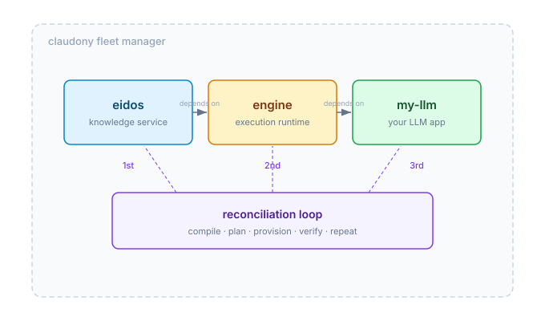
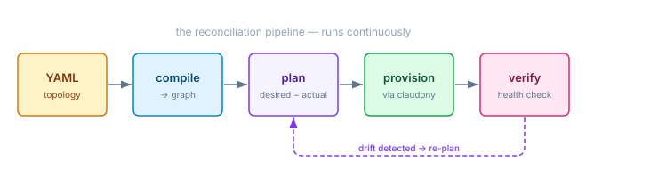
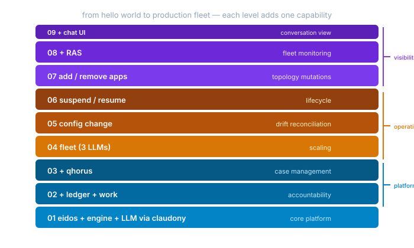

# The Minimum Honest LLM Deployment

I wanted to build the simplest possible CaseHub hello world. Deploy one app. Maybe a container. Something a developer could point at and say "that's what the platform does."

The honest answer turned out to be five services, not one.

## Why Five?

An LLM that can't access knowledge is a chatbot playing word games. It needs eidos — the knowledge service that gives it entities and context to reason about. An LLM without an execution runtime has no way to run block-defined workflows — it sits there with no instructions. It needs the engine.

And without a fleet manager, you're back to `docker run`. You can start a container. You can't tell it what to deploy, track whether it drifted, or suspend and resume it declaratively. That's claudony.

So the minimum honest deployment is:

**eidos** → **engine** → **my-llm**, all managed by claudony.



Three services with real dependency edges. Eidos starts first because engine depends on it. Engine starts before the LLM because the LLM needs the execution runtime. The ordering isn't a convention — it's enforced by the reconciliation loop's topological planner. Get it wrong and the deployment fails. Get it right and you never think about it again.

## The YAML Is the Deployment

The entire topology is one YAML file:

```yaml
desiredState:
  namespace: casehub
  name: hello-llm

nodes:
  eidos:
    type: casehub_application
    spec:
      applicationId: eidos
      image: casehubio/eidos:latest
      deploymentTarget: claudony
      replicas: 1

  engine:
    type: casehub_application
    dependsOn: [eidos]
    spec:
      applicationId: engine
      image: casehubio/engine:latest
      deploymentTarget: claudony

  my-llm:
    type: casehub_application
    dependsOn: [engine]
    spec:
      applicationId: my-llm
      image: casehubio/my-llm-app:latest
      deploymentTarget: claudony
      config:
        llm.provider: anthropic
        llm.model: claude-sonnet-4-20250514
```

No imperative deploy script. No ordered list of `kubectl apply` commands. The YAML declares what you want. The reconciliation loop figures out how to get there.

## What the Reconciliation Loop Actually Does

This is the part that makes desiredstate management more than a config file.



The loop compiles your YAML into a dependency graph, diffs it against actual state, plans transitions in topological order (prune before grow — always), provisions through claudony, then verifies health. If something drifts — a config changes, a service goes down, a new version appears — the loop detects it and re-plans. Only the diff is applied. The rest is left alone.

This is why claudony has to be the deployment target from day one. Without it, you're testing a reconciliation loop that doesn't reconcile anything real. The "hello world" with a stub target is just a YAML parser with extra steps.

## Where This Goes

Each level in the progression adds exactly one platform capability. The hello world is level 01 — the foundation that everything else builds on.



Level 02 adds ledger and work — every deployment is audited, every task generates a work item. Level 03 adds qhorus for full case management. Level 04 scales to a fleet. Levels 05–07 are the operational capabilities that make desiredstate management worth the abstraction: drift reconciliation, suspend/resume lifecycle, declarative topology mutations. Level 08 adds fleet monitoring via RAS. Level 09 puts a chat UI on top.

Each level is a YAML file with tutorial comments explaining what's new. Drop the file into the test directory and the framework discovers it automatically. No Java changes needed to add a topology. The YAML IS the tutorial.

The progression is deliberately iterative — each level gets its own assessment before the next begins. What we learn at level 02 might reshape level 03. The spec captures the vision; the implementation discovers the truth.

The gap between "deploy a container" and "manage a fleet" is where most platforms lose developers. They start simple and then hit a cliff when they need ordering, drift detection, lifecycle management. CaseHub's answer is that the reconciliation loop handles all of it — but only if the hello world is honest about what a real deployment needs. Five services, not one. Claudony from the start.
