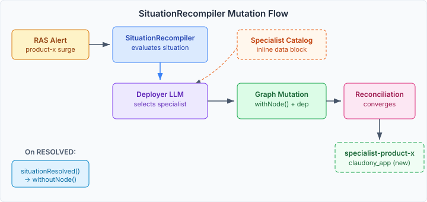
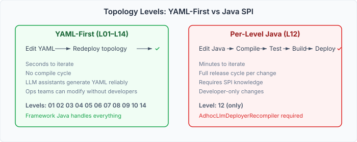

# The LLM That Deploys LLMs

Level 12 is the first topology where the system modifies itself. An LLM node watches RAS alerts, decides a specialist is needed, and mutates its own topology to add one. When the alert clears, it removes the specialist. No human in the loop.

The scenario: a support surge hits for product X. The deployer LLM receives the situation, looks up "product-x-specialist" in a catalog data block, and the `SituationRecompiler` adds a new `claudony_app` node to the graph with the right knowledge base config. The reconciliation loop provisions it. When the surge subsides, `situationResolved()` removes the node. The fleet shrinks back to its original size.



The topology YAML defines the deployer as a regular `claudony_app` node — same type as every other LLM in the fleet. It carries config for its role (`llm.role: deployer`, `deployer.specialist-catalog: specialist-catalog`) but structurally it's just another node. The specialist catalog is an inline data block listing the available profiles. The deployer selects; the recompiler constructs.

## The adaptation system we almost used

The interesting part wasn't the implementation — it was what we found during design review. The deployment module already has a complete adaptation rule system. `DeploymentAdaptiveSituationRecompiler` reads rules from YAML, matches situations to triggers, and applies actions — scale, add, update. Pure YAML. No per-level Java. When Claude surfaced this in the review, it changed the architecture: instead of building a standalone `SituationRecompiler`, I wanted to extend the existing framework with an LLM-evaluated trigger type.

Two things stopped us. `AdaptationTrigger` only supports pattern matching — situation name plus confidence threshold. An LLM-evaluated trigger is a fundamentally new type that the framework doesn't have a slot for. And `AddActionSpec` is coupled to `DeploymentGoals` through `DeploymentGoalCompiler`, which means it can only add deployment-domain nodes, not `claudony_app` nodes.

So Level 12 got a Java `SituationRecompiler` — `AdhocLlmDeployerRecompiler` — that follows the adaptation rule pattern structurally (state tracking, circuit breaker, catalog lookup) but operates directly on the graph with `withNode()` and `withoutNode()`.

## The uncomfortable outlier

This made Level 12 the only topology level that requires per-level Java.



Every other level — L01 through L14 — is pure YAML. You write the topology, the framework compiles it, the runtime manages it. Adding a new adaptation rule is a YAML edit. Adding a new pool is a YAML edit. Even fault recovery (L14) uses the existing `ClaudonyFaultPolicy` unchanged.

Level 12 breaks this. Changing how the deployer selects specialists, adjusting the catalog matching logic, adding a new decision heuristic — all require a Java compile-test-build cycle. For a domain where every hot path is I/O-bound (provisioning takes seconds, LLM calls take hundreds of milliseconds), there's no performance argument for compiled code. The rule evaluation overhead is invisible.

The development velocity argument is stronger. YAML edits iterate in seconds. LLM coding assistants generate YAML reliably. Ops teams can modify rules without developers. A Java SPI implementation needs someone who understands the `SituationRecompiler` contract, the graph mutation API, and the state tracking semantics.

## What comes next

The follow-up (#189) extends the adaptation rule framework in two places: an `llm-evaluated` trigger type that delegates to a deployed LLM node, and a domain-agnostic add action that doesn't require `DeploymentGoalCompiler`. Once those land, Level 12's deployer becomes a YAML rule:

```yaml
adaptations:
  - name: deploy-specialist-on-surge
    trigger:
      type: llm-evaluated
      agent: deployer
      catalog: specialist-catalog
    actions:
      - type: add
        template: specialist-template
        dependsOn: [engine]
```

The Java recompiler gets deleted. Level 12 rejoins the YAML-first pattern. The proof-of-concept served its purpose — it proved the runtime flow works. The framework extension makes it operational.
