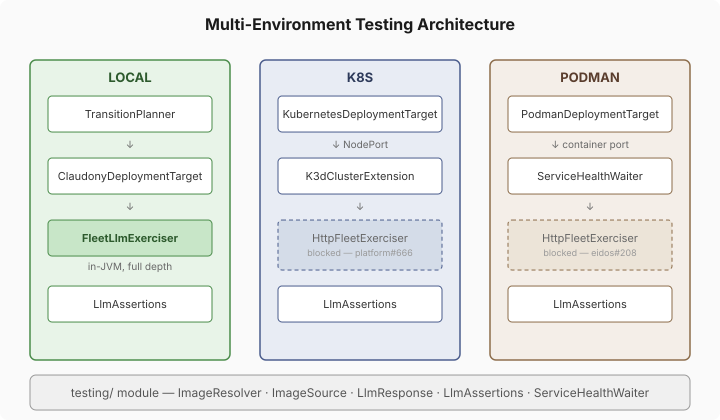

# Same Assertions Everywhere — Closing the Multi-Env Testing Gap

*Continues from [Layering the HTTP Bridge](2026-10-27-mdp01-layering-the-http-bridge.md), which covered the design phase.*

The design session for #207 surfaced six batches of work across four child issues. The headline: three target environments share the same deploy flow but not the same assertion depth. This session landed five of the six.

## What actually changed

The core problem was structural: `FleetLlmExerciser` owned both the in-JVM exercise logic (send a prompt through LangChain4j, get a response) and the assertion contract (`LlmResponse`, `assertSubstantive`, `assertDomainRelevant`, `assertDifferentiated`). K8S and PODMAN couldn't use the assertions because they lived inside a class that required classpath-level agent wiring.

The fix was to separate the contract from the mechanism. `LlmResponse` and `LlmAssertions` moved to the `testing/` module — the same place that already houses `ImageResolver`, `ServiceHealthWaiter`, and `TargetEnvironment`. `FleetLlmExerciser` kept its `exercise()` method for LOCAL in-JVM use but lost the inner record and the static assertion methods. Eleven test classes across topology-tests updated their imports.

## The image source decision

`ImageResolver` gained context-based tiers: `LOCAL`, `REGISTRY`, `FALLBACK`. The key decision was mutually exclusive selection, not a fallback chain. A chain sounds friendlier — try local first, fall back to registry, then nginx:alpine. But it silently degrades test correctness. A developer changes code locally, runs tests, and the chain pulls a stale registry image because the local build hasn't happened yet. Tests pass. The bug ships.

Each context gets exactly one source. Dev must build locally or fail loud. CI uses the registry image it just built. Smoke tests explicitly opt into nginx:alpine. No silent degradation.

## NodePort over port-forwarding

The K8S deployment target had been using fabric8's `LocalPortForward` for `serviceUrl()` — creating a tunnel from a random host port to the K8S service. It worked, but it was test-only plumbing with no path toward production networking.

We replaced it with NodePort services. `assignNodePort()` deterministically maps a service name to a port in the 30080-30099 range using a hash. `K3dClusterExtension` pre-maps all twenty ports via `withExposedPorts()` at K3s container startup, then injects the host and port mappings into the test class via `@K3dNodeHost` and `@K3dPortMappings` annotations. `serviceUrl()` now reads the NodePort from the Service spec and translates through the K3d mapping — same URL shape as production would use, just different port numbers.

Claude caught two things during review: `Math.abs(Integer.MIN_VALUE)` returns a negative number (fixed with bitmask), and `docker pull` could hang indefinitely without a timeout (fixed with `waitFor(5, MINUTES)` and a background output drain).

## The consolidation

Two `KubernetesDeploymentTarget` classes existed — a stub in `app/` that returned "not yet implemented" for everything, and a full fabric8 implementation in `topology-tests/`. The stub was dead code from an early scaffold. We deleted it and moved the real implementation to `deployment/target/`, where it belongs alongside `InProcessDeploymentTarget`.

One quirk: the `.gitignore` rule `target/` matches the Java package path `deployment/target/`. Files need `git add -f` to stage. We added a negation rule (`!**/src/**/target/`) so future files in that package don't hit the same friction.

## What's blocked

The HTTP fleet exerciser — the piece that gives K8S and PODMAN the same functional assertion depth as LOCAL — needs a platform endpoint that doesn't exist yet. `POST /api/agent/chat` with an `AgentResolver` SPI is filed as platform#666; eidos implementing the resolver is eidos#208. Both need to land before the exerciser can be built.

This is the right ordering. The shared assertion contract and image resolver are prerequisites anyway — they needed to exist before the HTTP exerciser could return an `LlmResponse` and run `LlmAssertions` against it. The infrastructure is in place. The bridge is what's missing.
