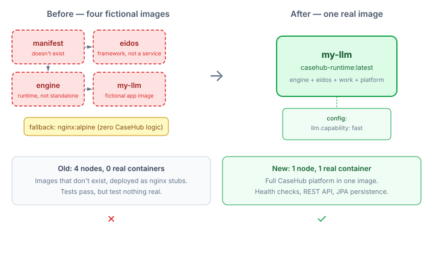
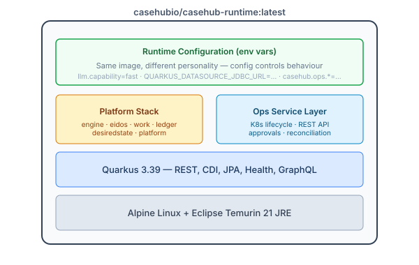

# One Image to Rule Them All

A few weeks ago I wrote about the [minimum honest LLM deployment](2026-10-14-mdp01-minimum-honest-llm-deployment.md) — the argument that a real CaseHub hello world needs at least three services, not one. Eidos for knowledge, engine for execution, the LLM app itself. I was right about the architecture. I was wrong about the packaging.

Those three images didn't exist. Neither did the fourth (manifest). The Level 01 topology YAML referenced `casehubio/eidos:latest` and `casehubio/engine:latest` as if they were real Docker images. They weren't. Eidos is a framework. Engine is a runtime. Neither is a standalone deployable. The test workaround was `allow-image-fallback=true`, which deployed four nginx:alpine containers — proving the plumbing worked while exercising zero CaseHub functionality.

I was writing a tutorial for a platform that couldn't actually run its own tutorial.

## The Fictional Decomposition Problem

The four-node topology was aspirational microservices thinking applied at the wrong stage. It imagined a world where each CaseHub module ships as its own service: eidos here, engine there, manifest over there. That world might exist someday. It doesn't exist now, and pretending it does created a worse problem than the one it tried to solve.



The per-service decomposition assumed each module had:
- Its own build pipeline
- Its own Dockerfile
- Its own CI workflow
- Its own versioning story

That's four of everything for a hello world. And since none of it existed, the topology was fiction tested against fiction.

## One Image, All Modules

The fix is a universal runtime image. One Quarkus application with the CaseHub platform stack on the classpath — engine, work, platform, desiredstate — plus the ops service layer with its K8s lifecycle management, REST APIs, and reconciliation infrastructure. Build once, push once, deploy everywhere with different configs.



The key insight came from looking at what was already true about CaseHub's architecture: modules are Jandex libraries that activate by CDI classpath discovery. They're designed to coexist. `CrossDomainCompositionEngine` handles multi-domain routing. `GoalCompiler` produces nothing without declared goals. `ReconciliationLoop` only starts when explicitly triggered. The modules are inert without configuration.

So we don't need an activation mechanism at all. No `@IfBuildProperty` gates, no profile switching, no feature flags. The config map in the topology YAML controls what the container does — not what it is. Same image, different personality.

The Level 01 topology went from this:

```yaml
nodes:
  manifest:
    type: casehub_application
    spec:
      image: casehubio/manifest:latest     # doesn't exist
  eidos:
    type: casehub_application
    spec:
      image: casehubio/eidos:latest         # framework, not a service
  engine:
    type: casehub_application
    spec:
      image: casehubio/engine:latest        # runtime, not standalone
  my-llm:
    type: casehub_application
    spec:
      image: casehubio/my-llm-app:latest    # fictional
```

To this:

```yaml
nodes:
  my-llm:
    type: casehub_application
    spec:
      image: casehubio/casehub-runtime:latest
      config:
        llm.capability: fast
```

One node. One real image. The container starts in under five seconds, passes health checks, and serves real REST API requests with JPA persistence against an H2 database. Not nginx. Not a stub. A running CaseHub instance.

## What It Actually Proves

I deployed the image to Podman and hit it with HTTP requests. POST to `/api/ops/applications` creates an application entity and writes it to the database. GET reads it back. The health endpoint reports UP with three checks passing: workflow engine readiness, database connectivity, worker recovery.

This is what the e2e test does — the same sequence, automated:

1. Create a container from `casehub-runtime:latest`
2. Wait for `/q/health/ready` to return 200
3. POST an application through the REST API
4. GET it back, verify it persisted
5. Confirm the container reports PRESENT
6. Stop and remove it, confirm ABSENT

Seven ordered tests, all passing. The topology test suite still runs its 117 existing tests with zero regressions — the YAML change from four nodes to one is backward-compatible at the compilation level; the test assertions just needed updating for the new node count.

## Why Per-Service Decomposition Fails at This Stage

The instinct to decompose early is strong. Microservices thinking says "separate concerns, deploy independently, scale individually." That's sound advice for production systems with known traffic patterns and operational teams. It's terrible advice for a research platform with zero users and no images.

Per-service decomposition before you have services is like writing deployment scripts before you have code. The abstraction doesn't compress anything — it multiplies the things that don't exist yet.

The universal image inverts this. Start with one image that does everything. When you hit a real scaling bottleneck or a real deployment constraint, extract the module that needs independence. The extraction is a packaging change, not an architectural one — the modules are already separate at the code level, with clean SPI boundaries and disjoint `NodeType` claims. Thin per-service images are an optimisation for later, not a prerequisite for now.

## Where the Gaps Are

The design called for including all domain modules — deployment, compliance, claudony — alongside the platform stack. In practice, domain modules like deployment need runtime implementations of qhorus and RAS that aren't available as standalone dependencies. Adding them caused cascading CDI resolution failures: ambiguous `ApplicationDeploymentTarget` (three implementations, no discriminator), unsatisfied `SituationRegistrar` (RAS runtime not on classpath), missing `ClaudonyFleetClient` (no CDI-managed constructor).

The runtime module currently matches the `app/` module's proven dependency set — the platform stack without domain-specific extensions. Later topology levels that need containers running their own reconciliation loops will require those domain deps, and those deps will require their host runtimes. This is a dependency-availability problem, not an architectural one.

## What This Opens Up

The universal image unblocks three things that were stuck:

**Real topology tests.** Levels 02 through 14 can replace `nginx:alpine` fallbacks with actual CaseHub instances. Drift detection tests can detect real drift. Lifecycle tests can suspend and resume real containers. The topology YAML becomes a specification that runs, not a specification that pretends to run.

**Scaffold deployment.** The scaffold project's Deploy tab can provision real CaseHub apps via Podman. One image reference, one pull, one container — the UI doesn't need to know which modules are inside.

**Onboarding.** A new developer builds one image, not four repos. `mvn package -pl runtime -DskipTests && docker build` — two commands, one image, everything works. The gap between "I cloned the repo" and "I have a running CaseHub" shrinks to minutes.

The honest minimum deployment turned out to be simpler than I thought. Not three services. Not four. One image, configured by what you put in the YAML. The architecture was always modular. The packaging just needed to catch up.
