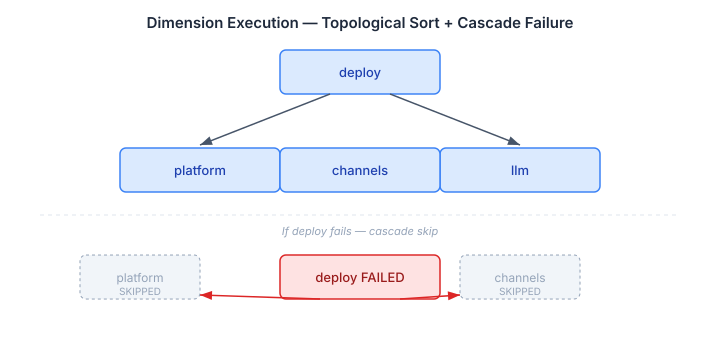
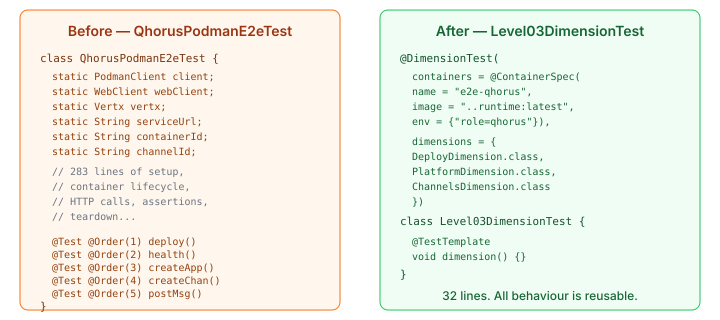

# The Test Is the Tutorial

The Level 03 topology rewrite started as a mechanical task: replace seven fictional container images with three real nodes using the universal runtime. It ended somewhere more interesting — with a test framework that proves a system works, teaches people how it works, and does both from the same source code.

## The Gap Nobody Noticed

The original Level 03 topology had seven nodes: manifest, eidos, engine, ledger, work, qhorus, my-llm. Each with its own fictional Docker image. The acceptance test deployed all seven, verified they started, and declared success. But "started" is a low bar. The containers were nginx proxies standing in for services that didn't exist as standalone deployables. The test proved the orchestration worked. It proved nothing about whether the software did anything useful.

When the rewrite consolidated seven nodes to three — platform, ledger, qhorus — the natural question was: what do the tests actually prove now? The topology deploys. The reconciliation plan is correct. The audit trail covers the graph. But does the case management stack *work*?

That question exposed a deeper gap. The qhorus node was declared as a "genuine service boundary" in the topology — it manages channels and protocol state independently. But when I looked at the runtime image, qhorus wasn't on the classpath. The container had no qhorus functionality. The topology declared a boundary that didn't exist.

## From Copy-Paste to Contract

Adding qhorus to the runtime and writing the first multi-dimension e2e test (deploy, platform CRUD, channel round-trip) proved the concept. But it also revealed the problem with how the tests were structured.

`QhorusPodmanE2eTest` was 283 lines. `HelloLlmPodmanE2eTest` was 198 lines. They shared 150 lines of identical boilerplate — Podman client setup, Vertx lifecycle, container creation via raw API calls, health-check polling, teardown. Every new topology level would copy this scaffold and add its own assertion methods. The test for Level 04 would duplicate everything from Level 03 plus its own fleet-scaling checks. By Level 08 the copy-paste chain would be unreadable.

The real problem was structural, not aesthetic. Each level *adds* capabilities — Level 03 has everything Level 02 has, plus channels. But the test code didn't reflect this. Each test was a monolith that re-implemented every capability check from scratch. There was no way to say "Level 03 is Level 02 plus channels" — you had to open both files and diff them manually to see what was different.

So I built a dimension framework.

## What a Dimension Is

A dimension is a reusable block of assertions that proves one capability works. It has a name, a set of dependencies on other dimensions, and an execute method that makes HTTP calls against a running service and verifies the results.

```java
public interface TestDimension {
    String name();
    Set<String> requires();
    void execute(ServiceUrls urls, DimensionState state) throws Exception;
}
```

No JUnit dependency. No test framework coupling. Pure Java contract. A dimension doesn't know how the container was deployed or what test runner invokes it. It knows how to exercise one capability and assert that it works.

The four initial dimensions map directly to what the existing tests were already checking — just extracted into named, reusable pieces:

- **deploy** — waits for the health endpoint, verifies the container is running. Requires nothing.
- **platform** — creates an application via REST, queries it back, verifies persistence. Requires deploy.
- **channels** — creates a channel, posts a message, retrieves it. Proves the round-trip. Requires deploy.
- **llm** — submits a prompt, validates the response structure. Requires deploy.

Each dimension reads shared state from prior dimensions (the service URL that deploy discovered, the application ID that platform created) and writes its own outputs for downstream use. The state flows through a simple string-keyed map — no compile-time coupling between dimensions, no type hierarchy to maintain.

## Dependency Order, Not Test Order

The old tests used `@Order` annotations to force sequential execution. Order 1 deploys, Order 2 checks health, Order 3 creates an app, Order 4 creates a channel. The ordering was implicit in the annotation values — if you removed a test or reordered them, everything broke silently.

The dimension framework replaces this with topological sorting. Each dimension declares what it `requires()`. The framework builds the dependency graph and runs dimensions in the correct order. Same-depth dimensions (platform and llm both require only deploy) run in alphabetical order for determinism.



If a dimension fails, every dimension that transitively depends on it is skipped — not failed, skipped. Independent dimensions still run. If deploy fails, platform and channels are skipped but the failure message tells you exactly why: "Skipped: dependency 'deploy' failed." If platform fails but channels only requires deploy, channels still executes. The dependency graph determines what gets skipped, not the test order.

## What the Test Looks Like Now

This is the complete Level 03 test:

```java
@DimensionTest(
    containers = @ContainerSpec(
        name = "e2e-qhorus",
        image = "localhost/casehubio/casehub-runtime:latest",
        env = {"role=qhorus"}),
    dimensions = {DeployDimension.class, PlatformDimension.class,
                  ChannelsDimension.class}
)
@Tag("integration-live")
class Level03DimensionTest {

    static ApplicationDeploymentTarget createTarget() {
        return TargetEnvironmentFactory.createTarget(
            TargetEnvironment.current(), Map.of());
    }

    @TestTemplate
    void dimension() {}
}
```



Thirty-two lines. The test class is pure declaration: which container to deploy, which dimensions to exercise. All behaviour lives in the dimensions — reusable across every level.

Level 01 is identical except for the container name and the dimension list: `{DeployDimension.class, PlatformDimension.class, LlmDimension.class}`. Level 04 will add `FleetDimension.class`. Level 06 will add `LifecycleDimension.class`. Each level is a one-line change to the dimension list.

## Why This Matters Beyond Clean Code

The dimension framework isn't just about removing duplication. It changes what the test suite communicates.

When someone opens `Level03DimensionTest`, they see instantly what Level 03 proves: deploy, platform, channels. They don't need to read 283 lines to understand that. When someone opens `Level06DimensionTest`, they'll see everything Level 03 proves *plus* lifecycle management. The test declaration IS the capability inventory for that level.

This matters for the tutorial vision. The strategy document describes a four-phase arc: Java dimension tests (now), YAML descriptors (next), scaffold UI integration (after that), continuous verification (the endgame). The `TestDimension` interface was designed with zero JUnit dependency specifically because a YAML runner needs to invoke the same dimension logic without being a JUnit extension. The Java tests are Phase 1. When the YAML runner arrives, it becomes a second caller of the same dimension implementations. Nothing changes in the dimensions themselves.

## Why This Matters More Than Architecture Diagrams

There is a widespread practice in software engineering of describing systems through architecture diagrams that nobody can run. Boxes, arrows, labels. The diagram says "Platform calls Qhorus which writes to Ledger." But does it? The diagram can't tell you. Only a running system can.

Topology levels are the running version of the architecture diagram. Level 01 proves one node serves real HTTP requests. Level 02 proves two nodes with a dependency deploy in the right order and produce an audit trail. Level 03 proves three nodes with genuine service boundaries serve real application logic — applications persist, channels deliver messages, state survives the round-trip.

Each level is a statement about the system's capabilities, executable as a test. If the test passes, the statement is true. If it fails, the statement is false. There is no gap between the documentation and the reality because the documentation *is* the reality.

The dimension framework makes this explicit. The test doesn't just pass or fail as a monolith — it passes or fails per capability. Platform CRUD works. Channel round-trip works. LLM response well-formed. Each dimension is a specific claim about the system, individually verifiable.

## What Each Level Teaches

The levels aren't just a test progression. They're a curriculum. Each level adds one capability and one lesson:

**Level 01** — the minimum honest deployment. One image, one interaction. *Lesson: you can deploy a CaseHub instance and talk to it.*

**Level 02** — audit matters. Two nodes, one dependency. *Lesson: the audit trail is independent of the platform's lifecycle.*

**Level 03** — service boundaries aren't arbitrary. Three nodes, but the third exists because it manages independent state. *Lesson: co-locate what's coupled, separate what's genuinely independent.*

**Level 04+** — each level adds one operational concern (fleet scaling, drift detection, lifecycle management, fault recovery) and shows how the desired-state model handles it declaratively.

A learner who completes Level 03 understands platform deployment, audit trails, and channel mesh. Not because they read documentation, but because they deployed it, exercised it, and saw it work. The test passed. The architecture is true.

## The Uncomfortable Realisation

The seven-node topology looked impressive. Seven services, each with its own image, its own lifecycle. It looked like a proper microservices architecture. It was fiction — seven labels for containers running nginx.

The three-node topology looks simpler. Three nodes, one real image. But it proves more. Each node exists for a reason: platform co-locates the tightly coupled modules, ledger isolates the audit trail, qhorus manages independent protocol state. And the test proves all three work — not as containers that start, but as services that serve.

Sometimes less architecture proves more system. And sometimes the best documentation is a test that runs.
