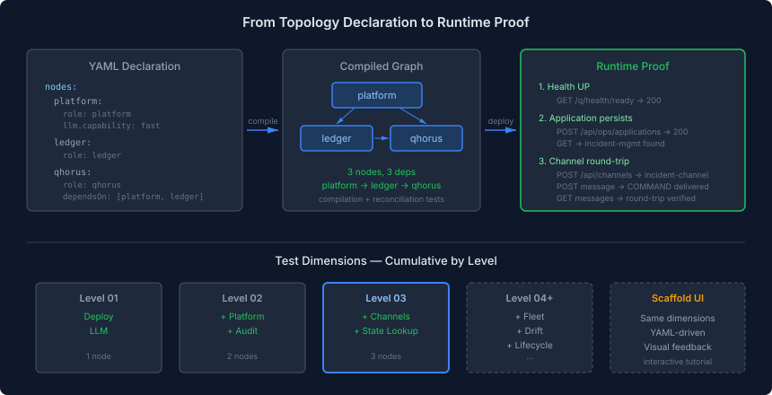

# The Test Is the Tutorial

The Level 03 topology rewrite started as a mechanical task: replace seven fictional container images with three real nodes using the universal runtime. It ended somewhere more interesting — with a test that creates an application, opens a channel, sends a message through it, and retrieves it. And with a question about what tests are actually for.

## The Gap Nobody Noticed

The original Level 03 topology had seven nodes: manifest, eidos, engine, ledger, work, qhorus, my-llm. Each with its own fictional Docker image. The acceptance test deployed all seven, verified they started, and declared success. But "started" is a low bar. The containers were nginx proxies standing in for services that didn't exist as standalone deployables. The test proved the orchestration worked. It proved nothing about whether the software did anything useful.

When the rewrite consolidated seven nodes to three — platform, ledger, qhorus — the natural question was: what do the tests actually prove now? The topology deploys. The reconciliation plan is correct. The audit trail covers the graph. But does the case management stack *work*?

That question exposed a deeper gap. The qhorus node was declared as a "genuine service boundary" in the topology — it manages channels and protocol state independently. But when I looked at the runtime image, qhorus wasn't on the classpath. The `role: qhorus` config was metadata. The container had no qhorus functionality. The topology declared a boundary that didn't exist.

## Closing the Gap

Adding qhorus to the universal runtime image was the obvious fix. Two Maven dependencies: `casehub-qhorus` (the Quarkus extension) and `casehub-qhorus-persistence-memory` (in-memory stores for dev). The build broke immediately — qhorus brings its own persistence unit, which conflicted with the existing datasource configuration. Standard Quarkus multi-persistence-unit wiring: configure a named datasource, assign entity packages, let CDI resolve.

The interesting part wasn't the dependency plumbing. It was writing a test that proves the runtime actually does something.

## What a Meaningful Test Looks Like

The test deploys a single universal runtime container via Podman. Same image that runs in production. Same classpath. Then it makes HTTP calls that exercise real application logic:

**Platform logic** — create an application called "incident-mgmt" via `/api/ops/applications`. Query it back. Verify the state persisted. This proves the platform's JPA layer, REST endpoints, and database are wired correctly. Not "the container started" but "I created a domain object and it's in the database."

**Qhorus logic** — create a channel called "incident-channel" with APPEND semantics via `/api/channels`. Post a COMMAND message: "create case for incident-2024-001." Retrieve the channel's messages. Verify the message arrived with the right sender, type, and content. This proves qhorus's channel mesh is active — channels persist, messages deliver, the round-trip works.



The test doesn't deploy three separate containers and hope they talk to each other. It deploys one container with all modules on the classpath — because that's what the universal runtime *is*. The modules are separate at the code level (different packages, different persistence units, different REST resources) but coexist in one process. The test exercises them in sequence, building state that carries across modules: an application created through platform, a channel managed by qhorus for that application.

## Why This Matters More Than Architecture Diagrams

There is a widespread practice in software engineering of describing systems through architecture diagrams that nobody can run. Boxes, arrows, labels. The diagram says "Platform calls Qhorus which writes to Ledger." But does it? The diagram can't tell you. Only a running system can.

Topology levels are the running version of the architecture diagram. Level 01 proves one node serves real HTTP requests. Level 02 proves two nodes with a dependency deploy in the right order and produce an audit trail. Level 03 proves three nodes with genuine service boundaries serve real application logic — applications persist, channels deliver messages, state survives the round-trip.

Each level is a statement about the system's capabilities, executable as a test. If the test passes, the statement is true. If it fails, the statement is false. There is no gap between the documentation and the reality because the documentation *is* the reality.

## The Path to Interactive Tutorials

This is where the vision gets practical. The same tests that prove the system works can teach people how it works. The sequence — deploy topology, create application, open channel, send message, verify — is already a tutorial in test form. Each step has a clear input (HTTP request), a clear output (response with state), and a clear lesson (what the system does and why).

The next step is extracting these test dimensions into YAML descriptors:

```yaml
level: 03
dimensions:
  - deploy
  - platform:
      create: { path: /api/ops/applications, body: { name: incident-mgmt } }
      verify: { path: /api/ops/applications, expect: { body_contains: incident-mgmt } }
  - channels:
      create: { path: /api/channels, body: { name: incident-channel, semantic: APPEND } }
      message: { path: /api/channels/{id}/messages, body: { sender: platform, type: COMMAND } }
      verify: { path: /api/channels/{id}/messages, expect: { body_contains: create case } }
```

The YAML descriptor runs in CI as a regression test. The same descriptor loads into the scaffold UI as an interactive tutorial — the user clicks "Run," sees the HTTP request and response, and gets a checkmark when it passes. The test is the tutorial. The tutorial is the test. One source of truth, two audiences.

## What Each Level Teaches

The levels aren't just a test progression. They're a curriculum. Each level adds one capability and one lesson:

**Level 01** — the minimum honest deployment. One image, one interaction. *Lesson: you can deploy a CaseHub instance and talk to it.*

**Level 02** — audit matters. Two nodes, one dependency. *Lesson: the audit trail is independent of the platform's lifecycle.*

**Level 03** — service boundaries aren't arbitrary. Three nodes, but the third exists because it manages independent state. *Lesson: co-locate what's coupled, separate what's genuinely independent.*

**Level 04+** — each level adds one operational concern (fleet scaling, drift detection, lifecycle management, fault recovery) and shows how the desired-state model handles it declaratively.

A learner who completes Level 03 understands platform deployment, audit trails, and channel mesh. Not because they read documentation, but because they deployed it, exercised it, and saw it work. The test passed. The architecture is true.

## The Uncomfortable Realisation

The seven-node topology looked impressive. Seven services, each with its own image, its own lifecycle. It looked like a proper microservices architecture. It was fiction — seven labels for containers running nginx.

The three-node topology looks simpler. Three nodes, one real image. But it proves more. Each node exists for a reason: platform co-locates the tightly coupled modules, ledger isolates the audit trail, qhorus manages independent protocol state. And the test proves all three work — not as containers that start, but as services that serve.

Sometimes less architecture proves more system.
